#  Whetstone

Interview practice for senior engineers, reviewed by a model that runs on
your own machine. Write a solution in the editor, run it against real
tests, get a scored review, and ask follow-up questions in a thread. When
you are stuck there is a hint ladder, and when you want more of the same
pattern the model writes a new problem for you.

A split view on desktop, and phone first on an iPhone 13 mini. Nothing leaves
the machine.

## What it looks like

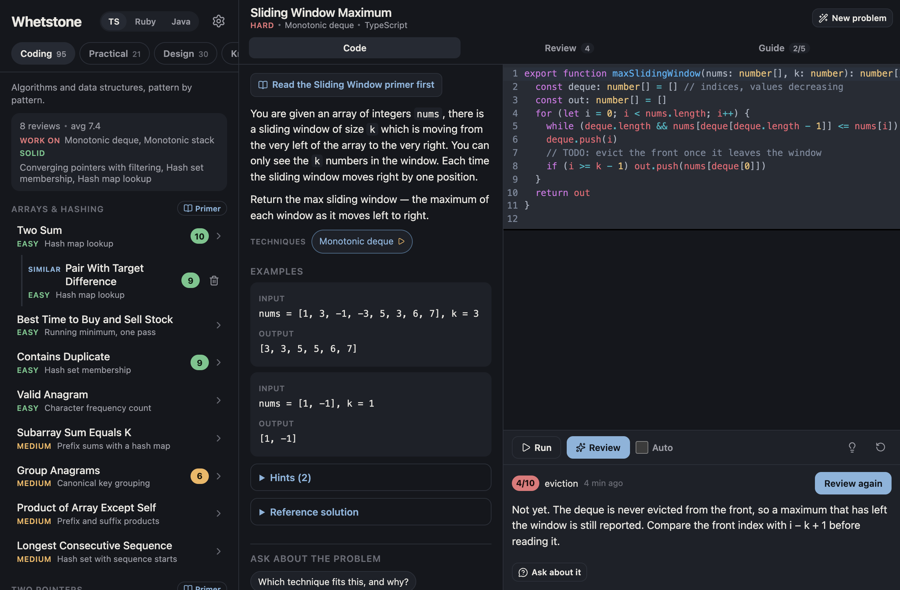

On a desktop the list, statement and editor sit side by side, here in Java, with the latest review under the draft it is about.

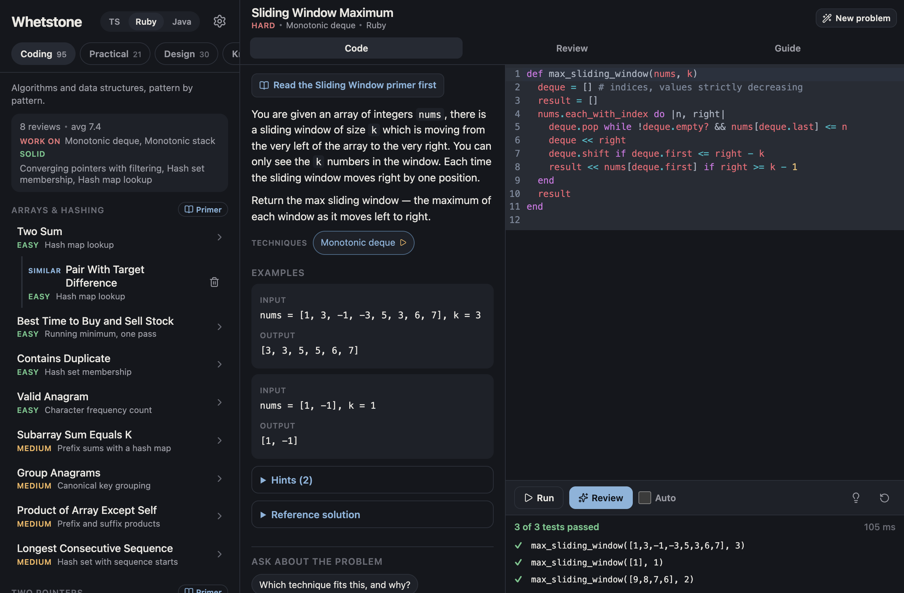

The same problem in Ruby, with all tests passing.

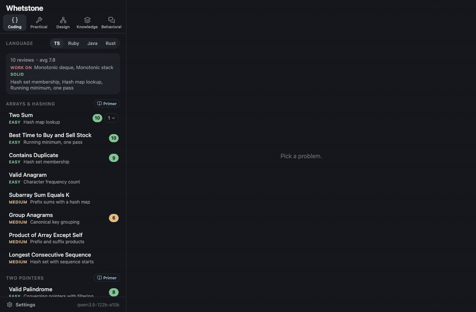

<p>On a desktop, a problem opens beside the editor, its code runs against the tests, and the review lands under it.</p>

<p align="center">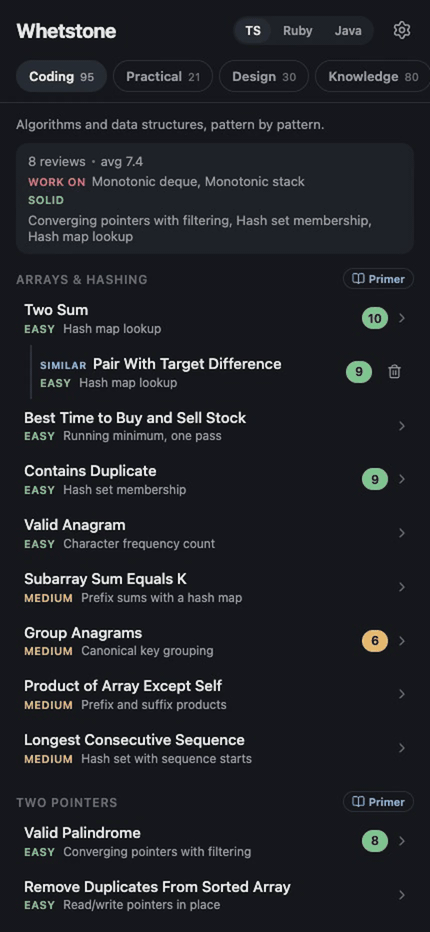</p>

<p align="center">The same flow on a phone.</p>

<table>
  <tr>
    <td width="260">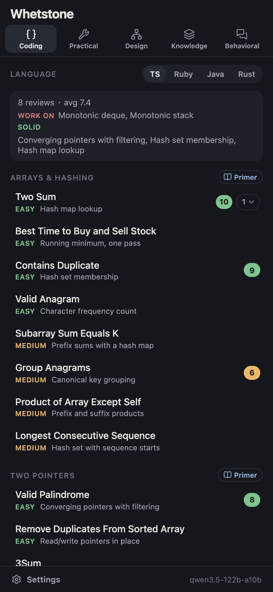</td>
    <td>The list shows the tracks across the top, progress per pattern, your scores, and a generated variant nested under its parent.</td>
  </tr>
  <tr>
    <td width="260">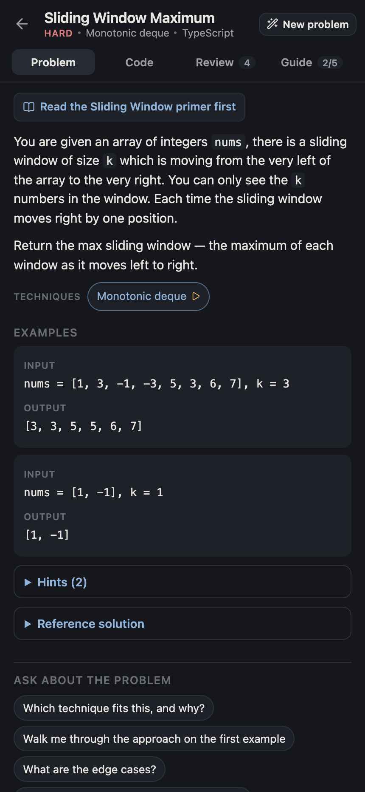</td>
    <td>A problem opens with its statement, the technique it exercises, examples, hints and a reference solution, with a tutor thread underneath.</td>
  </tr>
  <tr>
    <td width="260">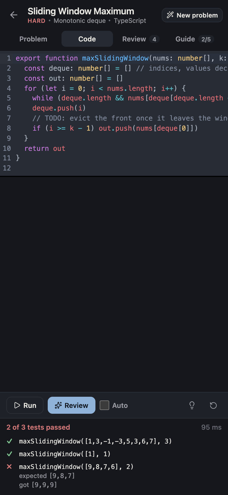</td>
    <td>Your draft runs against real tests in a sandbox; here one of three fails.</td>
  </tr>
  <tr>
    <td width="260">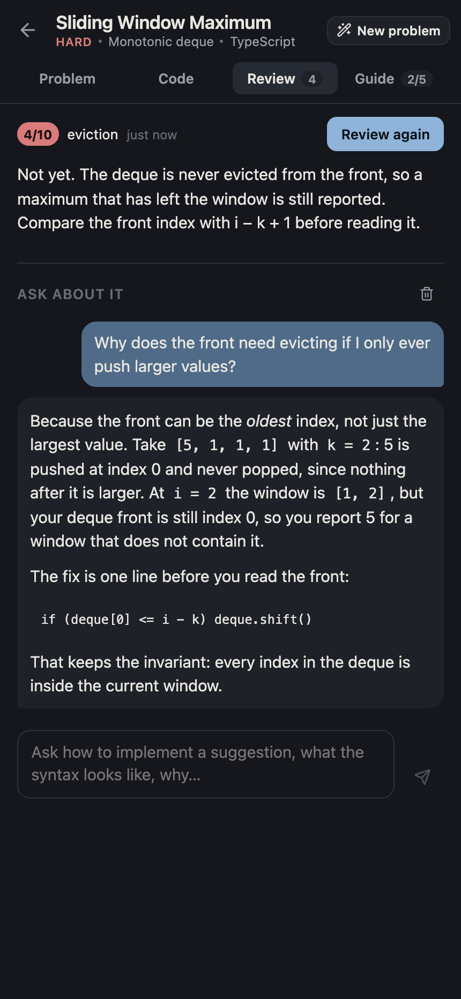</td>
    <td>The model scores the draft out of 10 and names one thing to focus on, and you can ask why.</td>
  </tr>
  <tr>
    <td width="260">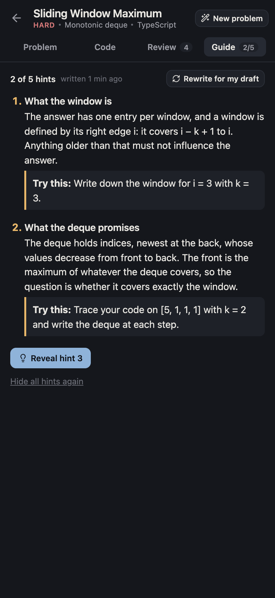</td>
    <td>The guide writes a hint ladder for your current draft and reveals it one rung at a time.</td>
  </tr>
  <tr>
    <td width="260">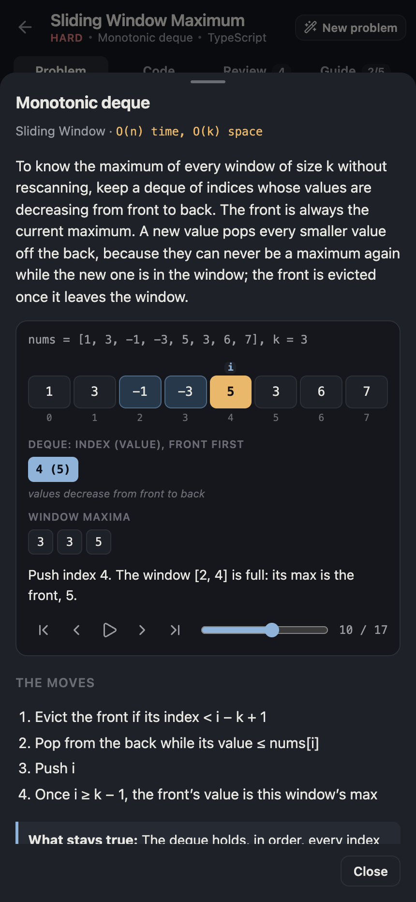</td>
    <td>Every technique comes with a plain-words explanation and, for most, a step-through visualisation.</td>
  </tr>
  <tr>
    <td width="260">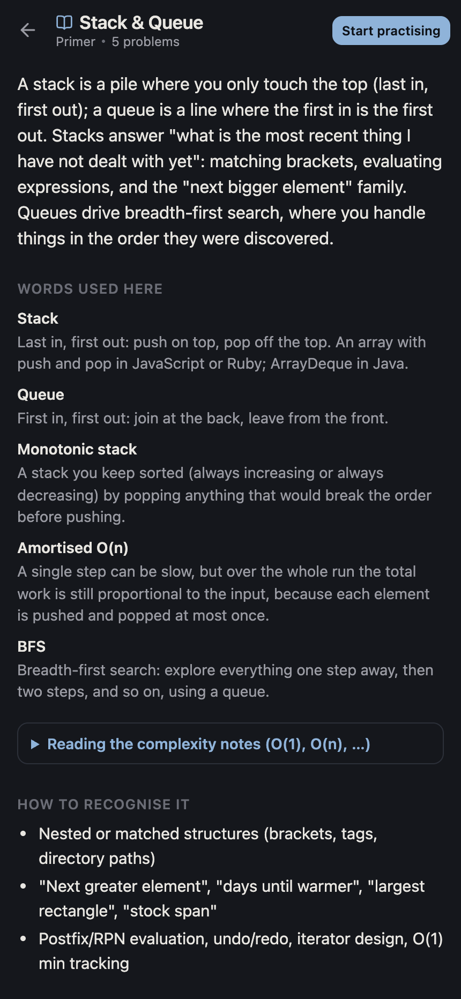</td>
    <td>Each topic has a primer on how to recognise the problem type and which techniques apply.</td>
  </tr>
  <tr>
    <td width="260">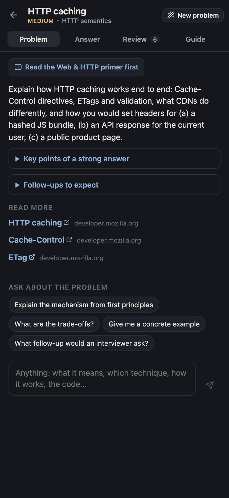</td>
    <td>Knowledge questions are answered in prose, with key points, follow-ups and links to the reference docs.</td>
  </tr>
  <tr>
    <td width="260">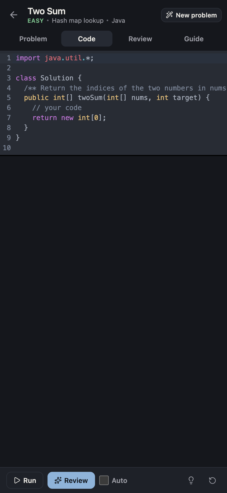</td>
    <td>Every coding problem exists in TypeScript, Ruby and Java, starters included.</td>
  </tr>
</table>

The screenshots use demo data. To regenerate them:

```bash
npm run seed:demo && npm run dev   # one terminal
npm run screenshots                # another; needs Google Chrome
```

## The five tracks

- **Coding** covers algorithms and data structures, grouped by pattern.
- **Practical** is everyday utilities: debounce, an LRU cache, a promise pool.
- **Design** poses system design prompts, reviewed against talking points.
- **Knowledge** asks questions you answer in prose, with key points to hit.
- **Behavioral** takes STAR-format stories, reviewed for structure and specifics.

Coding and Practical come in TypeScript, Ruby and Java. The toggle next to
the title picks the language.

## Before you start

### How it fits together

```
your phone or desktop browser
        │  http, over your own network
        ▼
Whetstone ── one Node process on one computer ── .data/ (SQLite)
        │
        ├──▶ a sandbox on that computer            (runs your code: node, ruby, javac/java)
        └──▶ a model server on the same computer   (reviews, hints, tutoring, new problems)
```

Whetstone is one Node process that serves the app to any browser on your
network and keeps your drafts, reviews and threads in SQLite on that
computer, so the phone and the desktop see the same thing. Your code runs
in Whetstone's own sandbox on that computer; the model only reads and
writes text, and gets the test results along with the draft. Your phone
talks only to Whetstone.

### What you need

| For | You need |
|---|---|
| Browsing problems, primers and techniques; writing and running TypeScript | Node 24 or newer |
| Running Ruby or Java solutions | `ruby`, or a JDK (`javac` and `java`), on the same computer |
| Reviews, hint ladders, tutor threads and new problems | A model server that speaks the OpenAI chat API (below) |
| Opening it on your phone | The phone on the same Wi-Fi, or [Tailscale](https://tailscale.com) on both devices (see *Keeping it running*) |

Node 24 is the floor because drafts and reviews are stored with
`node:sqlite`, which arrived in that version. Check with `node --version`.

Ruby and Java problems need their toolchains: `brew install ruby openjdk`
on a Mac. Settings shows which languages the computer can run; `server/langs.ts` lists where it
looks, and `WHETSTONE_RUBY` and `WHETSTONE_JAVA_HOME` override that.
Without a toolchain the problems can still be written, just not run.

### A model server

Whetstone talks to the model through the OpenAI chat API
(`/v1/chat/completions`), streamed, so any local server that offers it
works. Generating problems asks for a JSON schema, so the server must also
support `response_format: json_schema`. oMLX, LM Studio and llama.cpp's
server all do.

- **[oMLX](https://github.com/jundot/omlx)** is the default. Whetstone looks
  for it at `http://127.0.0.1:8000/v1` with `Qwen3.8-27B-MLX-8bit`, which
  the prompts are tuned on. Start oMLX with that model loaded and nothing
  needs setting.
- **[LM Studio](https://lmstudio.ai)**, as the example of any other server:
  download a model in its Discover tab and start the server in the
  **Developer** tab. In Whetstone's Settings set *Model server* to
  `http://127.0.0.1:1234/v1` and pick the model by the name the server
  uses (for example `qwen/qwen3.8-27b`). If the server asks for a token
  (in LM Studio, **Require Authentication**), paste it; it stays on the
  Whetstone server.

"Let the model think first" in Settings turns on the model's reasoning.
Off is faster. On is sometimes sharper on reviews and design critiques.

## Run

```bash
npm install
npm run dev          # http://localhost:8300, scratch database in .data-dev/
npm run check        # typecheck + lint + tests
npm run deploy       # build and restart the persistent instance on :8310
npm run seed:demo    # fill the dev database with demo data
npm run screenshots  # regenerate docs/screenshots/ from the dev server
```

On your phone, open the **Network** address that Vite prints (for example
`http://192.168.1.50:8300/`). Settings, drafts, reviews and threads are
stored server-side, so the phone and the desktop see the same thing.

### Keeping it running

The persistent instance is a launchd job (`com.amie.whetstone`) that runs
`vite preview` on :8310. Its data lives in `.data/`.

Install it once. Edit the three paths in `scripts/com.amie.whetstone.plist`
first (the `npm` binary, this checkout, and the log file), then:

```bash
cp scripts/com.amie.whetstone.plist ~/Library/LaunchAgents/
launchctl bootstrap gui/$(id -u) ~/Library/LaunchAgents/com.amie.whetstone.plist
```

To reach it from a phone, put it behind Tailscale Serve and open
`https://<your-machine>.<your-tailnet>.ts.net:8444`:

```bash
/Applications/Tailscale.app/Contents/MacOS/Tailscale serve --bg --https=8444 http://127.0.0.1:8310
```

The page is served from the browser's cache on every launch, so it opens
at once on the phone and says so if the server cannot be reached.

## How it works

### Content

Problems are plain data in `src/data/*.ts`. Every problem has a topic (how
the list groups it), a pattern (the skill it exercises), a difficulty and
the fields its track needs.

Code problems carry tests that name a function and give its arguments and
expected result as JSON. The same tests run in every language. Linked lists
travel as `{ val, next }` objects and trees as `{ val, left, right }`.

Practical problems are about closures, timers and promises, which JSON
cannot carry. Each one has a small driver in the starter that replays a
script against your code and returns plain data.

A test runs every reference solution, in every language, through the real
sandbox, so the content cannot drift.

### Languages

Every coding and practical problem has a hand-written Ruby and Java version
in `src/data/ports-*.ts`: a starter and a reference solution each. The ports
mirror the TypeScript ones; promises become threads or executors, and
AbortSignal becomes a small cancel token.

Your work is kept per language. Switching from TypeScript to Ruby on a
problem shows a fresh Ruby draft, with its own reviews, hints and threads.
The review, tutor and hint prompts all speak the selected language.

The Knowledge track has one language topic per language (TypeScript &
JavaScript, Ruby, Java). You see the one for the selected language; the
other topics are shared.

### Running code

Run writes your draft to a scratch directory and executes it under a
harness for that language: a child Node process for TypeScript, `ruby`, or
`javac` and `java`.

The harness finds the function by name (`twoSum` and `two_sum` both
resolve), converts the JSON arguments into that language's values, and
reports the raw results. Java does this by reflection on the method
signature, so `int[]`, `List<List<Integer>>`, `char[][]` and `ListNode` all
work. The comparison with the expected values happens once, on the server.

Every language gets a per-test and overall timeout and captured console
output. The sandbox is a convenience, not a security boundary.

### Reviews

A review streams from the model as you watch. The prompt depends on the
track: code with its test results, design notes against the talking points,
STAR for behavioral. It ends with a verdict line carrying a score out of 10,
whether the answer is correct, and a focus phrase.

Reviews are saved and aggregated per pattern into the progress shown on the
list.

**Auto** reviews a few seconds after you stop typing. It skips unchanged or
starter text, and queues one more review if you keep typing during one.

### Hints and tutoring

There are three ways to get help, all written by the model and all saved.

- **Guide** writes a hint ladder for your current draft: five to seven rungs,
  from the gentlest nudge to a full plan, each with one thing to try and
  never the code. Rungs are revealed one at a time. "Rewrite for my draft"
  makes a new ladder from where you are now.
- **Ask about it**, under a review, is a thread where the model has your
  code, the test results and its latest review. It may show snippets.
- **Ask about the problem**, under the statement, is an open tutor for
  studying the problem: what it means, the edge cases, which technique
  applies and why, a walkthrough, the complexity, or the whole solution if
  you ask.

Primers have a thread too, tutoring from the primer's content. The last 12
turns ride along with each question.

### Primers and techniques

Each topic has a primer: how to recognise the problem type, each technique
with when, how and complexity, a code template, pitfalls, and what to say
out loud. Primers open from the topic header on the list and from a link
at the top of every problem.

Techniques are a catalogue, matched to a problem by its pattern. The chips
under a statement open a sheet with a plain-words explanation, the moves,
the invariant, the template, and for most techniques a step-through
visualisation: the real algorithm runs on a small example and records one
frame per step. Hide the chips in Settings for interview-style practice.

Knowledge questions link the reference page behind them: MDN where MDN
covers it, the tool's own documentation where not.

### New problems

"New problem" asks the model for an easier, similar or harder problem on the
same pattern. You can steer it in free text, for example "keep practising
hash lookups but focus on counting".

- **Similar** keeps the difficulty and the core technique but changes the
  scenario, so you can drill one pattern by repetition.
- **Easier** and **similar** stay under the parent's pattern. **Harder** may
  name its own pattern when the twist changes the core technique, so the
  chips and progress stay right.
- For code, the model's own solution is run against the tests it wrote.
  Failing tests are dropped and the result says how many were verified.
- The request lists the titles already on that pattern, so repeated drills
  stay distinct.

A generated problem is written in the selected language. Opening it in
another language shows a "Write it in …" button; the port is saved once its
solution passes the same tests.

### Loading

The list screen ships without the editor. CodeMirror, the Ruby and Java
grammars, the visualiser and the ports are separate chunks fetched on first
use, and hashed assets are served as immutable. The Java harness is
compiled once per server and reused.

## Stack and layout

Vite 8 + React 19 + TypeScript, a Vite plugin server with SQLite
(`node:sqlite`), Vitest and oxlint.

```
server/   api.ts (routes), store.ts (SQLite), llm.ts (chat client),
          prompts.ts (review, variant and port prompts), runner.ts (sandbox)
          with harness-ts/ruby/java.ts and langs.ts
src/      App.tsx, components/, hooks/, lib/api.ts, data/ (content), viz/
public/   sw.js, the app shell cache
scripts/  deploy.sh, com.amie.whetstone.plist, seed-demo.ts, screenshots.mjs
docs/     screenshots/ for this README
```
